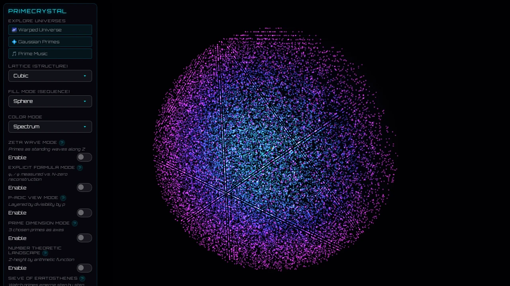
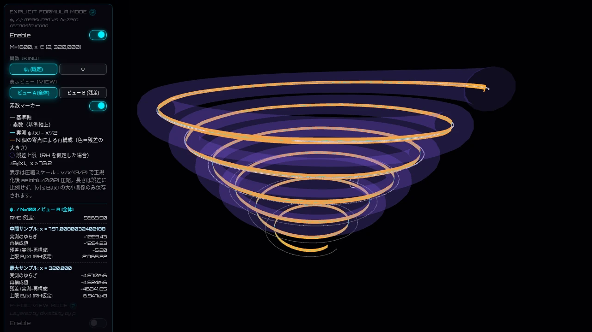
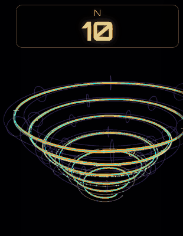

# 3D Prime Spiral Universe

An interactive 3D WebGL visualization exploring the distribution of prime numbers within various space-filling lattices. This project is a unique collaborative creation between multiple AI models (**Gemini** and **Claude**), pushing the boundaries of mathematical visualization.

[**🚀 Live Demo / ライブデモはこちら**](https://ypsilonmeister.github.io/3d-prime-spiral-universe/)

32万個の整数を3次元空間に配置し、素数の織りなす幾何学的な構造を探索できるビジュアライザーです。本プロジェクトは、**Gemini** と **Claude** という二つのAI知能の共作によって誕生しました。



*Default 3D Prime Spiral (`Cubic` / `Sphere`, 320,000 integers, `Spectrum`). / メインの3D素数スパイラル（Cubic / Sphere、32万点、Spectrum）。*

## Screenshots | スクリーンショット

### Zeta Wave Mode
Riemann Zeta zeros superposed as standing waves along the Z-axis (`Amplitude: 5.0`, `Linear` sheet). / リーマンゼータ関数の非自明零点をZ軸方向の定在波として重ね合わせた表示。


### Explicit Formula Mode
Measured $\psi_1(x) - x^2/2$ (cyan), reconstruction from the first $N=100$ zeta zeros (amber ribbon), prime markers, and the RH-assumed Schoenfeld error shell $\pm B_1(x)$ ($x \ge 73.2$, violet) with live numeric HUD. / 実測のゆらぎ $\psi_1(x) - x^2/2$（シアン）、先頭 $N=100$ 個の零点による再構成（オレンジ帯）、素数マーカー、RH仮定下の誤差上限殻 $\pm B_1(x)$（紫）と数値HUD。





*N sweep, `N = 10 → 1000` (25 frames): the reconstruction from the first $N$ zeta zeros, with the large N read-out. The $\pm B_1(x)$ shell is an error bound visualized under the RH assumption (not a proven bound). / Nスイープ（N = 10 → 1000）。RHを仮定した誤差上限の可視化であり、証明済みの上限ではありません。*

## Features | 主な機能

- **AI Collaborative Creation:** Built through the synergy of Gemini and Claude, combining different perspectives on number theory and computer graphics.
- **320,000 Data Points:** High-performance rendering using GPU custom shaders, displaying integers from 1 up to 320,000.
- **Digital Morphing Labels:** Distant "stars" seamlessly transform into glowing digits (Nixie tube style) as you zoom in.
- **11 Lattice Structures:** Explore space-filling geometries including Cubic, Hexagonal Prism, Truncated Octahedron, Rhombic Dodecahedron, Gyroid, and more.
- **8 Fill Sequences:** Watch numbers populate space via Spherical Shell, Diamond (L1), Vortex, Modular ÷6, and Z-Order curves.
- **Interactive Help Tooltips:** Built-in guidance for complex mathematical modes, explaining the concepts directly within the UI.
- **Multi-View Stereo & WebXR:** Integrated Parallel/Cross-eyed stereoscopic modes and Immersive VR support (`immersive-vr`).

### Advanced Mathematical Modes | 高度な数学的モード

- **Zeta Wave Mode:** Visualizes the non-trivial zeros of the Riemann Zeta function as standing waves along the Z-axis, showing how primes are encoded in the zeros.
- **p-adic View Mode:** Numbers cluster onto concentric shells based on their p-adic valuation $v_p(n)$ (divisibility by a chosen prime $p$).
- **Prime Dimension Mode:** Select three primes to act as X, Y, and Z axes, revealing how numbers factorize across dimensions.
- **Number Theoretic Landscape (NTL):** Z-height represents arithmetic functions like divisor count $d(n)$, abundance ratio $\sigma(n)/n$, distinct prime factors $\omega(n)$, Möbius function $\mu(n)$, and Euler's totient $\phi(n)$.
- **Sieve of Eratosthenes Animation:** Watch the classical algorithm eliminate composites step-by-step, revealing the golden primes.

## Sub-Universes / 関連プロジェクト

The repository also includes standalone visualizations and dedicated entry points exploring different aspects of number theory:
- **Riemann Hypothesis & Primes (`/rh` — [Live Demo](https://ypsilonmeister.github.io/3d-prime-spiral-universe/rh/)):** Dedicated entry into Explicit Formula Mode, visualizing $\psi_1(x) - x^2/2$, $N$-zero reconstructions, and the RH-assumed error bound shell $\pm B_1(x)$ (not a proven bound). / リーマン予想と素数（明示公式モード専用入口）：実測 $\psi_1(x) - x^2/2$、$N$ 個の零点による再構成、RH を仮定した場合の誤差上限殻 $\pm B_1(x)$ を可視化します。
- **Warped Number Theory Universe (`/warpednt`):** A new visualization exploring space with custom mathematical metrics and warp strengths.
- **Gaussian Primes (`/gaussianprimes`):** Visualization of primes in the complex plane.
- **Prime Music (`/primemusic`):** Auditory exploration of prime distributions.

## Controls | 操作方法

### Mouse / Touch
- **Rotate:** Left Click + Drag / Single Touch + Drag
- **Zoom:** Mouse Wheel / Pinch In-Out
- **Pan:** Right Click + Drag / Two Fingers + Drag
- **Toggle UI:** Double Tap (Mobile)

### Keyboard
- **[H]**: Hide/Show UI (メニューの表示・非表示)
- **[C]**: Center view on "1" (黄金の「1」に視点をリセット)
- **[G]**: Toggle Auto-Grow mode (宇宙の自動成長)

## Mathematical Background & Tech | 数学的背景と技術

- **Web Workers:** Heavy number theoretic computations (Sieve, NTL tables, Zeta offsets) are offloaded to a Web Worker, ensuring a fluid 60FPS UI.
- **GPU Acceleration:** Point sizes, colors, and dynamic texture atlas coordinate generation are handled entirely in a custom GLSL `ShaderMaterial`.
- **Zero-Copy Transfers:** Uses Transferable Objects (`ArrayBuffer`) to pass massive mathematical arrays between the Worker and the Main thread instantly.

## Setup | セットアップ

Since it uses ES Modules, it requires a local server to run.

```bash
# Using Python
python -m http.server

# Using Node.js
npx serve .
```

## Tech Stack | 使用技術

- [Three.js](https://threejs.org/) - 3D Engine
- GLSL (Custom ShaderMaterial) - GPU Rendering
- Vanilla JavaScript (ES Modules)
- HTML5 / CSS3

---
Created with ❤️ by **Gemini CLI** & **Claude**
